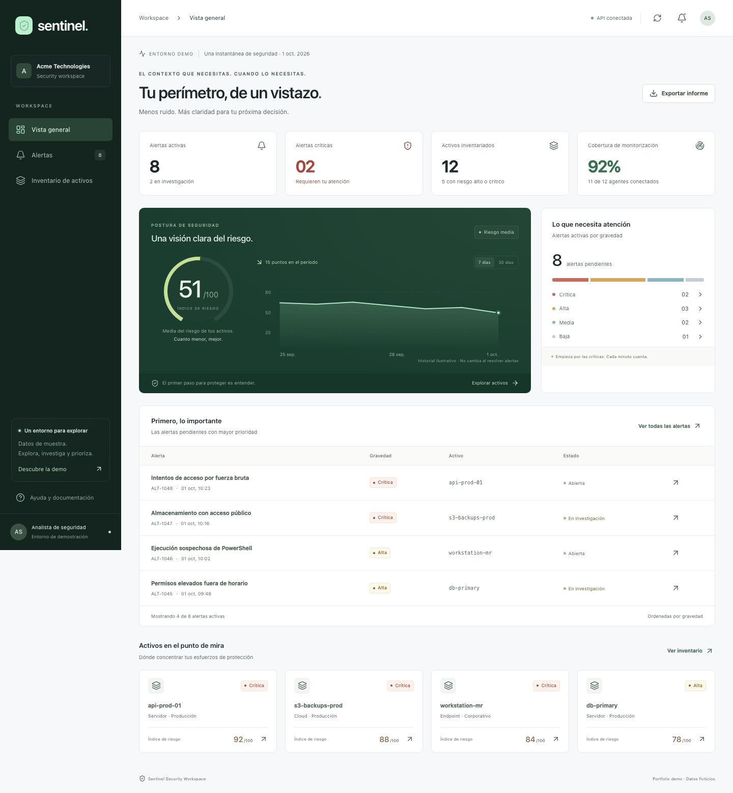

# Sentinel · Security Workspace

Una interfaz de ciberseguridad para entender **qué ocurre, qué activo está afectado y qué revisar primero**. Proyecto de portfolio en español, preparado a partir de una oferta de Junior Frontend: alertas, inventario y estados de riesgo que se puedan leer en segundos.



## Instalación y visualización

### Requisitos

- Node.js **22 o superior**, con npm (incluido al instalar Node.js).
- Git para clonar el repositorio. También puedes descargarlo con **Code → Download ZIP** en GitHub y descomprimirlo.
- Un navegador moderno. No necesitas cuentas, claves, archivo `.env` ni una base de datos.

Comprueba que Node.js y npm están instalados:

```bash
node --version
npm --version
```

### 1. Descargar el proyecto

Abre una terminal y ejecuta:

```bash
git clone https://github.com/SuliAragon/Demo-CiberSeguridad-Fronted-Dashboard.git
cd Demo-CiberSeguridad-Fronted-Dashboard
```

Si descargaste el ZIP, abre la terminal dentro de la carpeta descomprimida donde está `package.json`.

### 2. Instalar las dependencias y arrancar

```bash
npm ci
npm run dev
```

Deja la terminal abierta mientras usas la aplicación. `npm ci` instala las versiones del archivo `package-lock.json`; no es necesario instalar Next.js ni Tailwind por separado.

### 3. Abrir la demo

Abre [http://127.0.0.1:3000](http://127.0.0.1:3000) en el navegador.

| Pantalla               | Dirección local                                                |
| ---------------------- | -------------------------------------------------------------- |
| Vista general y riesgo | [http://127.0.0.1:3000](http://127.0.0.1:3000)                 |
| Alertas de seguridad   | [http://127.0.0.1:3000/alertas](http://127.0.0.1:3000/alertas) |
| Inventario de activos  | [http://127.0.0.1:3000/activos](http://127.0.0.1:3000/activos) |

Para probar el flujo principal, abre una alerta crítica, revisa sus evidencias, asigna un responsable y guarda el estado «En investigación». Después puedes resolverla y localizarla en «Resueltas». En **Ayuda y documentación → Restablecer demo** puedes volver al estado inicial.

Para detener el servidor, pulsa **Ctrl+C** en la terminal. El enlace de GitHub muestra el código y las capturas; la demo interactiva se ejecuta con estos comandos.

### Ejecutar la versión de producción

Después de instalar las dependencias, ejecuta:

```bash
npm run build
npm start
```

Abre la misma dirección, [http://127.0.0.1:3000](http://127.0.0.1:3000). Si tenías `npm run dev` abierto, detenlo antes para liberar el puerto.

### Si aparece un problema al arrancar

| Mensaje o situación                         | Qué hacer                                                                                 |
| ------------------------------------------- | ----------------------------------------------------------------------------------------- |
| `node` o `npm` no se reconoce               | Instala Node.js 22 o superior y vuelve a abrir la terminal.                               |
| No se encuentra `package.json`              | Entra en la carpeta del proyecto antes de ejecutar `npm ci`.                              |
| Puerto 3000 ocupado / `EADDRINUSE`          | Detén el otro servidor o usa `npm run dev -- --port 3001` y abre `http://127.0.0.1:3001`. |
| No se puede abrir la página                 | Comprueba que la terminal del servidor sigue abierta y que muestra «Ready».               |
| Error al descargar dependencias             | Comprueba la conexión a Internet y vuelve a ejecutar `npm ci`.                            |
| `npm start` indica que falta la compilación | Ejecuta primero `npm run build`.                                                          |

## Qué puedes hacer

- **Vista general:** alertas pendientes, críticas, cobertura de agentes, media de riesgo, distribución por gravedad y activos prioritarios. El historial ilustrativo alterna entre 7 y 30 días.
- **Alertas:** buscar por título, ID, fuente, activo o responsable; combinar gravedad y estado; ordenar, paginar y exportar los resultados a CSV.
- **Investigación:** abrir evidencias y recomendaciones, consultar el activo, asignar un analista y cambiar entre abierta, en investigación y resuelta.
- **Inventario:** buscar por nombre, dirección, propietario o etiqueta; filtrar por tipo, entorno y riesgo; alternar entre tabla y tarjetas; revisar las alertas de cada activo.
- **Estados de interfaz:** carga, error con reintento, lista vacía, guardado fallido y notificaciones de resultado.
- **Accesibilidad y móvil:** navegación adaptable, etiquetas de formulario, gravedad expresada con texto, foco visible, diálogo nativo con cierre por Escape y enlace para saltar al contenido.
- **Exportación:** CSV de la instantánea y de las filas filtradas; escapa comillas y neutraliza valores que podrían interpretarse como fórmulas.

## Stack

| Tecnología         | Uso en el proyecto                                                                        |
| ------------------ | ----------------------------------------------------------------------------------------- |
| TypeScript         | Tipos de dominio, estados y contratos de la API                                           |
| React              | Componentes, estado compartido y formularios                                              |
| Next.js App Router | Rutas de pantalla, layout y Route Handlers REST                                           |
| Tailwind CSS 4     | Integración con PostCSS, utilidades y composición de estilos con `@apply`                 |
| CSS                | Sistema visual propio, superficies, gráficos y adaptación a distintos tamaños             |
| Lucide             | Iconos coherentes y ligeros                                                               |
| Vitest             | Prioridad, umbrales de riesgo, validación y CSV                                           |
| Playwright + axe   | Flujos completos en Chromium de escritorio y móvil, auditoría automática de accesibilidad |
| Git / GitHub       | Proyecto listo para versionar; CI incluida                                                |

Las versiones instaladas y reproducibles están en `package-lock.json`.

## API REST de demostración

| Método | Ruta              | Resultado                                               |
| ------ | ----------------- | ------------------------------------------------------- |
| GET    | `/api/alerts`     | `{ data: Alert[] }`                                     |
| GET    | `/api/assets`     | `{ data: Asset[] }`                                     |
| PATCH  | `/api/alerts/:id` | Valida estado y responsable; devuelve `{ data: Alert }` |

Ejemplo de cambio:

```json
{ "status": "investigating", "owner": "Ana García" }
```

Estados admitidos: `open`, `investigating`, `resolved`. Los analistas válidos se definen en `src/lib/types.ts`. Los errores devuelven `400` para un cuerpo inválido y `404` para una alerta inexistente. El cliente utiliza `fetch`, comprueba el resultado HTTP y limita las peticiones a 10 segundos.

**La API es stateless y usa datos ficticios.** PATCH valida y devuelve el cambio; no escribe en una base de datos. El cliente conserva los cambios en `localStorage`, aislados por navegador. Al recargar o actualizar datos, combina la instantánea de la API con esos cambios. «Restablecer demo», dentro de Ayuda, elimina solo esta información de Sentinel. Si el almacenamiento está bloqueado, el usuario recibe un aviso y el cambio dura únicamente en la sesión actual.

## Cómo se calcula el riesgo

Cada activo tiene una puntuación de muestra entre 0 y 100: bajo 0–29, medio 30–59, alto 60–79 y crítico 80–100. El índice general es la media redondeada de los 12 activos: **51/100**. La cobertura es 11 agentes conectados de 12: **92 %**.

Las alertas pendientes se ordenan por gravedad y, dentro de la misma gravedad, por fecha descendente. Las resueltas aparecen después de las pendientes al elegir todas. Resolver una alerta actualiza los contadores; no altera el riesgo de un activo. El historial es una serie de muestra independiente. Esta separación evita confundir el progreso de una investigación con una reducción de exposición que no se ha verificado.

## Comprobaciones

```bash
npm run check
npx playwright install chromium
npm run test:e2e
```

`check` ejecuta lint, TypeScript, pruebas unitarias y compilación. Las pruebas de navegador cubren investigación, persistencia tras recarga, filtros, páginas, exportación, navegación móvil, errores de API y de guardado, respuestas HTTP y accesibilidad automática. Las capturas en `docs/screenshots` se regeneran en esas pruebas.

La auditoría automática comprueba reglas WCAG A/AA en las tres pantallas y el detalle de alerta. Es una comprobación parcial; no sustituye pruebas con lectores de pantalla ni una auditoría completa.

## Estructura

```text
src/app/                 Pantallas y API REST
src/components/          Layout, vistas, tablas, detalles y proveedor de estado
src/lib/                 Dominio, datos, prioridad, validación y CSV
e2e/                     Flujos de navegador y accesibilidad
docs/                    Decisiones, guion de demo, candidatura y capturas
.github/workflows/       Verificación automática
```

## Qué demuestra y qué queda fuera

Demuestra una interfaz funcional y mantenible con lectura de API y un flujo de triage completo. No es un producto de seguridad listo para producción: no tiene autenticación, autorización, escaneo, ingestión de telemetría, auditoría de cambios ni persistencia de servidor. Las recomendaciones son texto de demostración y no ejecutan acciones sobre sistemas.

El siguiente paso sería sustituir los fixtures por un backend autenticado, guardar las investigaciones y su historial de forma transaccional, validar también las respuestas de servicios externos y calcular riesgo a partir de evidencia real.
